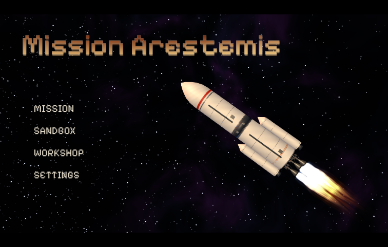
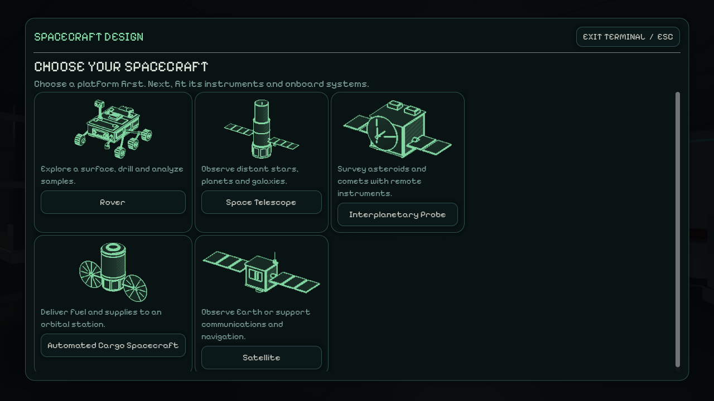

# Mission Arestemis

**Design a spacecraft. Build its launcher. Follow your mission into space.**

A first-person educational space engineering game set at **Hyperion Spaceport**, built with Godot for the web.

## About the game

Explore the spaceport, meet its engineers and scientists, and turn a mission brief into a working spacecraft and launch vehicle. Carry your designs between computers on a physical data cartridge, resolve pre-launch checks, then watch the mission unfold in a retro-styled cinematic.

The focus is on understanding engineering choices: payload requirements, power, mass, thrust, staging and the velocity needed to reach a destination. Flight and science are simplified for learning; the game is not a manual orbital flight simulator.

## Features

- **Mission mode** — an engineer-guided introduction, mission selection, spacecraft design, rocket assembly and pre-launch verification.
- **Sandbox** — start beside the payload scientist, choose a spacecraft and experiment with its systems and launcher.
- **Rocket Workshop** — save successful designs, reopen them in Sandbox and exchange JSON blueprints with other players.
- **Interactive spaceport** — NPC advice, voiced typewriter dialogue, computer workstations and objective guidance.
- **Mission cinematics** — countdown, lift-off, 3D trajectory views, stage separation, payload deployment and a result screen.
- **Local saves and settings** — separate campaign and Sandbox progress, graphics presets and audio controls.

## Play

**[Play in your browser](https://the-karol.github.io/mission-arestemis/)**

Status: playable development build. A keyboard and mouse are required. The first load downloads the game assets and may take a little while.

For a packaged Windows build, extract the archive and run **Start Game.bat**. Keep its local server window open while playing. No Godot or Python installation is needed. Use a browser with WebGL 2 and hardware acceleration; do not open `index.html` directly.

See the [player guide](docs/TESTING_README.md) for the first mission, saving and troubleshooting, or the [launch demo guide](docs/LAUNCH_DEMO_README.md) for the separate cinematic demonstration.

## Controls

| Input | Action |
| --- | --- |
| WASD / mouse | Move / look |
| Shift / Space | Run / jump |
| E | Interact |
| Q | Put down a cartridge |
| J | Read the selected mission dossier |
| Esc | Pause / leave an interface |
| Delete in an editor | Remove the selected component |
| Tap / hold Space during flight | Next sequence / 4x playback |

## Share a rocket

1. Complete a successful mission and select **SAVE TO WORKSHOP**.
2. Open **WORKSHOP** from the main menu.
3. Select **EXPORT FILE** and send the downloaded JSON file to another player.
4. The recipient selects **IMPORT BLUEPRINT**, then **OPEN IN SANDBOX**.

A blueprint includes the launcher and its spacecraft. Workshop data and progress are stored locally in the browser, without cloud synchronization. Export important blueprints before clearing site data or changing computers.

## Run from source

1. Clone this repository.
2. Open `project.godot` in **Godot 4.7.2** and allow asset imports to finish.
3. Press **F5** to start the game.

The project uses the **Compatibility** renderer and a single-threaded web export. See the [deployment guide](docs/DEPLOYMENT.md) for updating GitHub Pages and the [development guide](docs/DEVELOPMENT.md) for project structure, export tools, focused checks and static hosting notes. Export templates must match the engine version; generated builds and local caches are not included in the repository.

## Feedback

Please [open an issue](https://github.com/The-Karol/mission-arestemis/issues) with the mode, mission, browser, graphics preset and steps to reproduce. Screenshots and exported blueprints help reproduce assembly problems.

## AI disclosure

This game was developed using AI, with the concept, requirements, feedback and creative direction provided by **The-Karol**. AI was used for programming, gameplay systems, interface implementation, debugging and documentation. Existing models and audio were integrated into the project; this statement does not claim that every included asset was generated by AI.

See [project metadata](project-metadata.json) for the machine-readable disclosure.

## Credits and license

See [texture credits](TEXTURE_CREDITS.md) for documented texture sources. No open-source license is currently declared for this project; included assets may have their own terms.
